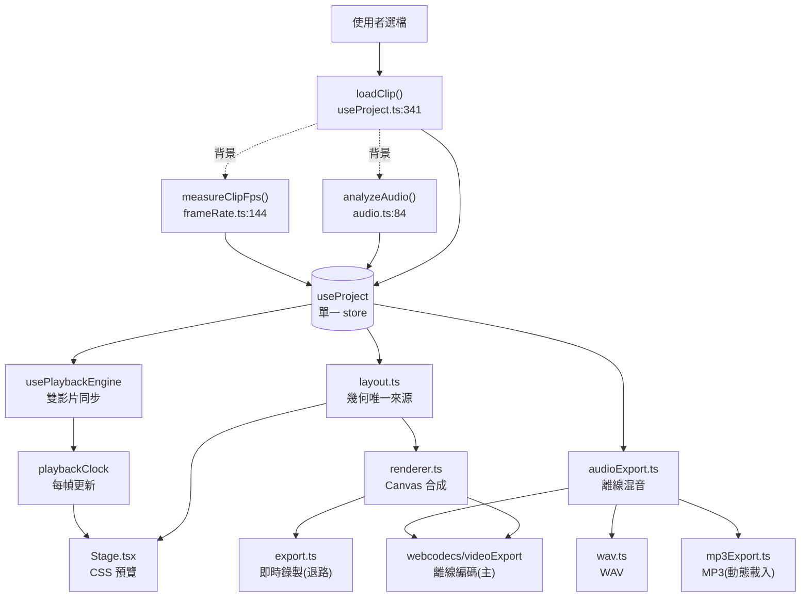

# 程式結構說明

這份文件回答一個問題:**要改的東西在哪個檔案**。

跟 [README](../README.md) 的分工:README 講「為什麼這樣設計」(踩過哪些坑、放棄了哪些做法),這份講「什麼東西在哪裡、怎麼串起來」。要理解某個決定背後的理由,看 README;要找程式碼,看這份。

檔案引用一律寫成 `路徑:行號`。

---

## 0. 三十秒版本



三件事撐起整個專案:

1. **單一 store** — 所有狀態在 `useProject`,沒有第二個真相來源
2. **幾何只有一份** — 預覽走 CSS、匯出走 Canvas,但數字全部來自 `layout.ts`
3. **時間分兩層** — `playbackClock` 每幀更新給 rAF 讀,store 只保留 10Hz 鏡像給 React

---

## 1. 先懂三組座標系

不懂這三組換算,看任何一個檔案都會覺得數字很奇怪。

### 1.1 專案座標系 ↔ 螢幕像素

所有版面計算都在**專案座標系**裡做,單位是輸出影片的像素。尺寸由輸出比例決定(`types.ts:16` `ASPECT_SIZES`):9:16 是 1080×1920、1:1 是 1080×1080、16:9 是 1920×1080。

換算到螢幕**刻意不用 JavaScript 量測**。舞台用 container query 單位做 contain-fit,內部一律百分比(`Stage.tsx:48`)。所以旋轉螢幕、網址列收合、鍵盤彈出都不需要通知任何人。

### 1.2 內容時間 ↔ 專案時間

加了預備拍之後,時間軸上多出一段本來不存在的空間,於是同一個時刻有兩種說法:

| | 意思 | 誰用 |
| --- | --- | --- |
| **內容時間** | 影片素材自己的時間軸 | 剪輯範圍、影片偏移 |
| **專案時間** | 時間軸上看到的位置,含預備拍 | 播放頭、標註、匯出範圍 |

換算全在 `timeline.ts`:

- `contentToProject()` — `timeline.ts:26`
- `projectToContent()` — `timeline.ts:34`(落在預備拍裡時**凍結**在插入點)
- `isInCountIn()` — `timeline.ts:41`
- `relativeToCountIn()` — `timeline.ts:59`

預備拍插在**剪輯起點**,不是插在最前面。剪掉開頭之後,預備拍要緊接著要練的段落。

### 1.3 原片座標 ↔ 畫面座標

裁切框存的是**原片的 0..1 座標**(`types.ts` 的 `CropRect`)。所以換輸出比例、換對比模式、平移縮放都不會讓裁切跑掉 —— 它講的永遠是「影片的哪一塊」。

鏡像時畫面上的左邊其實是原片的右邊,靠 `crop.ts:26` `mirrorCrop()` 換算(對合函數,來回共用同一支)。

---

## 2. 檔案地圖

### `src/lib/` — 純邏輯,不碰 React

| 檔案 | 負責 |
| --- | --- |
| `types.ts` | 資料模型:`Clip`、`ClipTransform`、`CropRect`、`Annotation`、`ASPECT_SIZES` |
| `layout.ts` | **版面幾何唯一來源**,預覽與匯出都只從這裡取數字 |
| `crop.ts` | 裁切框的純幾何:拉框、鏡像換算、邊界夾制 |
| `timeline.ts` | 內容時間 ↔ 專案時間 |
| `sync.ts` | 從屬影片的漂移校正參數與演算法 |
| `playbackClock.ts` | 每幀更新的播放時間(刻意放在 store 外面) |
| `frameRate.ts` | 影格率量測與吸附 |
| `renderer.ts` | Canvas 合成(匯出路徑的畫面) |
| `zoom.ts` | 以游標為錨點的縮放 |
| `fft.ts` | radix-2 FFT 與互相關 |
| `audio.ts` | 音量包絡抽取 + 自動對齊 |
| `tempo.ts` | BPM 與重拍相位偵測 |
| `metronome.ts` | 預備拍 click 的合成 |
| `audioBus.ts` | 共用的 `AudioContext` 與 `MediaElementSource` 快取 |
| `audioExport.ts` | 離線混音(影片匯出與純音訊匯出共用)、純音訊匯出的入口 |
| `mp3Export.ts` | MP3 編碼(LAME WASM),只在選了 MP3 時動態載入 |
| `audioPreview.ts` | 波形繪製(時間軸色條 + 純音檔佔位畫面) |
| `wav.ts` | `AudioBuffer` → WAV |
| `export.ts` | MediaRecorder 即時錄製 —— **只在 WebCodecs 走不通時當退路** |
| `mediaSupport.ts` | 檔案選擇器相容性、解碼失敗的錯誤訊息 |
| `format.ts` | 時間格式化 |
| `clipColors.ts` | A/B 兩支的識別色 |

### `src/lib/webcodecs/` — 離線編碼(動態載入)

| 檔案 | 負責 |
| --- | --- |
| `capabilities.ts` | 這台裝置編得出什麼格式 |
| `decodeProbe.ts` | 這支素材解不解得開、實際格率、是不是 VFR |
| `frameSource.ts` | 循序取出影格(mediabunny `CanvasSink`) |
| `composite.ts` | **合成時間軸** —— 由素材的影格時刻決定,不是固定格率 |
| `videoExport.ts` | 離線編碼主流程 |

> 整包是 `import()` 動態載入的。它連著 mediabunny,minify 後 648KB、佔整包八成以上,但只有匯出才用得到。首屏因此是 87KB(gzip)。

### `src/store/` 與 `src/hooks/`

| 檔案 | 負責 |
| --- | --- |
| `store/useProject.ts` | zustand 單一 store:狀態 + 所有 action |
| `hooks/usePlaybackEngine.ts` | 雙影片同步播放引擎(整個專案最核心的迴圈) |
| `hooks/useTrim.ts` | 剪輯規則,桌機列與手機面板共用 |
| `hooks/useMetronome.ts` | 播放時排程預備拍的 click |
| `hooks/useMediaQuery.ts` | 桌機/手機版面切換 |

### `src/components/`

| 檔案 | 負責 |
| --- | --- |
| `App.tsx` | 桌機 / 手機兩套版面的組裝 |
| `Stage.tsx` | 預覽舞台:影片圖層、手勢、標註拖曳 |
| `CropOverlay.tsx` | 裁切框(八個控制點 + 整塊搬移) |
| `Timeline.tsx` | 時間軸:刻度尺 + 兩條可拖曳的影片色條 |
| `Transport.tsx` | 播放控制列:播放/逐幀/時間/剪輯/速度 |
| `TrimBar.tsx` | 播放列上的剪輯(桌機) |
| `TrimPanel.tsx` | 分頁裡的剪輯(手機) |
| `ClipPanel.tsx` | 單支影片:載入、偏移、鏡像、縮放、音量、裁切、影格率 |
| `ModePanel.tsx` | 輸出比例與對比模式 |
| `AlignPanel.tsx` | 音訊自動對齊 |
| `CountInPanel.tsx` | 預備拍與 BPM |
| `AnnotationPanel.tsx` | 文字標註 |
| `CodecPanel.tsx` | 這台裝置的編碼能力 |
| `ExportPanel.tsx` | 匯出 |
| `ui.tsx` | `Panel` / `Button` / `Slider` / `Field` 與共用 input 樣式 |

---

## 3. 各層詳解

### 3.1 狀態:`store/useProject.ts`

單一 zustand store,777 行,沒有第二個狀態容器。

**狀態分組**

| 組 | 欄位 |
| --- | --- |
| 素材 | `clips`(`a` / `b`,各含 transform、crop、volume、fps、envelope、onset) |
| 版面 | `aspect`、`mode`、`opacity`、`blend`、`wipe` |
| 操作模式 | `adjustTarget`、`cropTarget`(**互斥**,兩者都要吃舞台的指標事件) |
| 時間 | `currentMs`(10Hz 鏡像)、`durationMs`、`playing`、`rate` |
| 剪輯 | `rangeInMs`、`rangeOutMs`、`splitAtMs`、`previousRange` |
| 預備拍 | `countIn`、`tempo`、`tempoStatus`、`tempoMessage` |
| 其他 | `annotations`、`align`、`loading`、`syncStrained` |

**衍生值不存進 state**,而是純函式現算:

| 函式 | 行 | 回傳 |
| --- | --- | --- |
| `countInPlan()` | `235` | 預備拍長度與 click 時間表 |
| `countInDurationMs()` | `251` | 預備拍佔多長 |
| `timelineMap()` | `266` | 內容/專案時間的換算依據 |
| `playRange()` | `287` | 實際要播放與匯出的區間 |
| `contentDurationMs()` | `303` | 不含預備拍的長度 |

**重要 action 的位置**

| Action | 行 | 備註 |
| --- | --- | --- |
| `loadClip` | `341` | 讀 metadata → 建 clip → 背景跑音訊分析與格率量測 |
| `removeClip` | `416` | 順手清掉 `adjustTarget` / `cropTarget` |
| `zoomClip` | `478` | 以格子中心為基準 |
| `setOffset` | `503` | 對齊偏移 |
| `detectTempoFromAudio` | `516` | BPM 偵測 |
| `splitAtPlayhead` | `568` | 切一刀 |
| `deleteSegment` | `581` | 刪掉一邊 |
| `seek` | `639` | **同時更新 `playbackClock`**,否則引擎會把畫面拉回舊位置 |
| `stepFrame` | `661` | 逐幀步進,步長取兩支裡最細的一格 |
| `addAnnotation` | `681` | |
| `autoAlign` | `717` | 音訊自動對齊 |
| `applyLag` | `772` | 依 `offsetB - offsetA = lag` 設定偏移 |

### 3.2 幾何:`lib/layout.ts`

**這是整個專案最重要的一個檔案。** 預覽(CSS)與匯出(Canvas)是兩套完全不同的實作,唯一保證它們畫出同樣東西的,就是兩邊都只從這裡取數字。

| 函式 | 行 | 用途 |
| --- | --- | --- |
| `slotRect()` | `22` | 某支影片在某個對比模式下佔的格子 |
| `croppedSize()` | `52` | 裁切後實際會被用到的來源尺寸 |
| `containSize()` | `58` | 影片(裁切後)contain 進格子的實際尺寸 |
| `cropFrame()` | `74` | 預覽用的裁切三層盒子幾何 |
| `cssTransform()` | `99` | 給 CSS 的 transform 字串 |
| `slotCoverage()` | `113` | 影片在格子裡佔到的面積比例 |
| `averageCoverage()` | `119` | 兩支平均佔多少畫面 |
| `bestAspect()` | `134` | 黑邊最少的輸出比例 |
| `resolveClipTime()` | `158` | 專案時間 → 單支影片的播放位置 |
| `drawClip()` | `178` | 把一支影片畫到 canvas |

**CSS ↔ Canvas 的對照**

| CSS(預覽) | Canvas(匯出) |
| --- | --- |
| `object-fit: contain` | `containSize()` |
| `transform: translate → scale` | `ctx.translate → scale` |
| `opacity` | `globalAlpha` |
| `mix-blend-mode: difference` | `globalCompositeOperation` |
| `clip-path: inset()` | `ctx.clip()` |
| `scale(-s, s)`(鏡像) | `ctx.scale(-s, s)` |
| 三層盒子 + `overflow: hidden`(裁切) | `drawImage()` 九參數版本 |

這個等價關係**有測試直接守著**(`layout.test.ts`):用一個會記錄所有呼叫的假 canvas context 跑 `drawClip()`,再把 `cssTransform()` 的字串解析出來逐項比對。

「裁切後放大填滿」不需要另外算放大係數 —— 只要讓 `containSize()` contain **裁切後**的尺寸,倍率自己就對了。

### 3.3 裁切:`lib/crop.ts` + `components/CropOverlay.tsx`

| 函式 | 行 | 用途 |
| --- | --- | --- |
| `resizeCrop()` | `crop.ts:37` | 拉某個控制點之後的新框(邊界、最小邊長、對邊釘住) |
| `mirrorCrop()` | `crop.ts:26` | 左右翻轉(對合函數) |
| `orientCrop()` | `crop.ts:29` | 鏡像時才翻轉 |
| `normaliseCrop()` | `crop.ts:83` | 等同全畫面就存 `null` |

`CropOverlay` 的座標對應刻意做得很單純:**overlay 的根元素就等於影片在畫面上佔的矩形**,拉框時直接用它的 `getBoundingClientRect()` 換算,不需要知道舞台多大。

裁切期間顯示的是**完整原片**(`Stage.tsx:359` 的 `cropping` 分支),不是即時套用的結果 —— 要選「留哪一塊」就得先看得到全部。放大填滿是按下「完成裁切」之後才發生的事。

### 3.4 時間與同步

**兩層時鐘**

| | 更新頻率 | 誰讀 |
| --- | --- | --- |
| `playbackClock.currentMs` | 每幀 | rAF 迴圈:播放引擎、播放頭、時間讀數 |
| `store.currentMs` | 10Hz | React:標註的出現與消失 |

播放時每幀寫 store 等於一秒觸發 60 次 React reconciliation,會跟影片解碼搶 main thread。所以逐幀步進與新增標註都讀**時鐘**,不讀 store —— 讀錯會差到三格。

**播放引擎** `hooks/usePlaybackEngine.ts:37`

專案時間以「其中一支正在播的影片」為準,不是牆鐘。

| | |
| --- | --- |
| 主控影片 | 直接拿它的 `currentTime` 當專案時間,永遠不校正 |
| 另一支 | 微調 `playbackRate` 慢慢追 |
| 都不在範圍 | 才退回牆鐘推進 |

`pickMaster()` — `usePlaybackEngine.ts:155` 挑**像素最多**的那一支當主控。主控永遠不會被 seek,所以這個位置要給撐不住的那一支;由便宜的那支去追。

**漂移校正參數** `lib/sync.ts`

| 常數 | 值 | 行 | 意思 |
| --- | --- | --- | --- |
| `HARD_SEEK_S` | 0.25 | `23` | 超過才值得付 seek 的停頓代價 |
| `MUTED_MAX_TRIM` | 0.1 | `30` | 靜音影片的速度修正上限 |
| `AUDIBLE_MAX_TRIM` | 0.03 | `36` | 有聲音的上限(再多會聽出來) |
| `DEADBAND_S` | 0.04 | `47` | 一格以內完全不修正 |
| `TRIM_GAIN` | 2 | `55` | 超出死區的部分換算成速度修正 |
| `RATE_STEP` | 0.01 | `67` | 修正量的量化階距 |
| `STRAIN_SEEK_LIMIT` | 3 | `77` | 5 秒內超過就判定裝置追不上 |

`correctDrift()` — `sync.ts:125`、`SeekStrainMonitor` — `sync.ts:93`。

### 3.5 渲染

**預覽** `components/Stage.tsx`

`ClipLayer`(`Stage.tsx:359`)是三層盒子:

```
格子(slot 大小,overflow: hidden)
└─ transform 層(整格大小 ← 百分比位移的基準必須是這個)
   └─ 裁切視窗(contain 後的大小,置中,overflow: hidden)
      └─ <video>(放大到 1/crop 倍,往左上推)
```

沒裁切時退化成原本的 `object-fit: contain`,同一條路徑。

> `<video>` 元素一定要留著,播放引擎靠它控制音訊 —— 純音檔也是靠這個元素播的,只是視覺上隱藏,改疊 `AudioPlaceholder`(`Stage.tsx:446`)。

其他圖層:`AdjustHighlight`(`Stage.tsx:323`)標出正在調整哪一格;`CropOverlay` 只在 `cropTarget` 有值時出現。

**匯出** `lib/renderer.ts:51` `renderFrame()`

畫面來源型別是 `CanvasImageSource` 而不是 `HTMLVideoElement`,因為有兩條匯出路徑:MediaRecorder 餵 `<video>`,WebCodecs 餵解碼出來的 canvas。共用同一支 `renderFrame`,才不會出現「預覽對、某一條匯出路徑錯」。

**時間軸** `components/Timeline.tsx`

整條軸畫在一張 canvas 上(`drawLane()` — `Timeline.tsx:339`、`pickTickStep()` — `Timeline.tsx:403`)。分成兩區:上方刻度尺拖播放頭、下方色條拖影片(`onPointerDown` — `Timeline.tsx:256`)。

拖曳期間凍結顯示長度,否則色條往右移、專案變長、整條軸跟著縮,手指會跟色條對不上。播放頭直接改 DOM style,不觸發 React re-render。

### 3.6 音訊

**自動對齊** `lib/audio.ts`

```
解碼(16kHz 單聲道) → 混單聲道 → 100Hz 音量包絡 → 對數壓縮
→ 正向差分(起音強度) → 正規化 → FFT 互相關 → 重疊區相關係數 → 找峰值
```

| 函式 | 行 |
| --- | --- |
| `analyzeAudio()` | `audio.ts:84` |
| `standardize()` | `audio.ts:125` |
| `alignOnsets()` | `audio.ts:159` |

比對的是**起音強度**而不是音量包絡:音量包絡會被兩支影片的錄音音量、EQ、環境噪音整體平移;正向差分只留下「音量突然變大」的瞬間,對響度差異免疫。

解碼取樣率 16kHz 是刻意的(`audio.ts:75`)—— 48kHz 立體聲三分鐘約 69MB,兩支就 138MB,在 iPhone 上很容易讓 Safari 直接回收分頁。

互相關走 FFT(`fft.ts:70` `crossCorrelate()`):兩段 3 分鐘的 100Hz 包絡各 18000 點,直接算是 3.24 億次乘法,FFT 約 65 萬次。

**BPM** `lib/tempo.ts:103` `detectTempo()`。範圍 60–200 BPM(`tempo.ts:22`),含諧波權重與先驗;信心度低於 `MIN_CONFIDENCE`(`tempo.ts:33`)就不宣稱測到。

**節拍器** `lib/metronome.ts`:`createClick()`(`:39`)合成單一 click,`scheduleClicks()`(`:76`)排整串。預覽與匯出共用同一份,音色與重音規則不會分岔。

**離線混音** `lib/audioExport.ts` `renderMixedAudio()` 走 `OfflineAudioContext`,把兩支的音訊 + 預備拍 click 混成一段 `AudioBuffer`。所有來源都經過一個 master `GainNode` 再出去 —— 純音訊匯出的「音量 %」就是調這個節點,素材與節拍器一起縮;影片匯出走預設的 1。

兩個消費端:純音訊匯出(`exportAudio()`)與 WebCodecs 影片匯出(→ `AudioEncoder`)。

**純音訊匯出的格式**:WAV 走 `wav.ts`(手寫 44 bytes 表頭,零相依);MP3 走 `mp3Export.ts` —— 瀏覽器的 WebCodecs 沒有 MP3 **編碼**器,所以掛 mediabunny 官方的 LAME 擴充,透過 custom coder API 註冊後 `AudioBufferSource({ codec: 'mp3' })` 自動用它。編碼器 304KB,只在選了 MP3 時 `import()`,而且**在混音之前**載 —— 載不到要在花時間混音前就失敗。

### 3.7 匯出

**主路徑** `lib/webcodecs/videoExport.ts:82` `exportWithWebCodecs()`

```
偵測編碼能力 → 讀檔 + 解碼探測 → 寫回實測格率 → 建 Output
→ 離線混音接上音軌 → 開影格來源 → 逐格合成 → finalize
```

順序刻意:**先檢查再編碼**。一旦 `output.start()` 之後才炸,使用者已經等了一段時間,而且只會拿到一句沒有資訊的「Decoding error」。

**合成時間軸** `lib/webcodecs/composite.ts:97` `composeTimeline()`

這是整個匯出最關鍵的一段。合成的時刻是**兩支素材影格時刻的聯集** —— 每一張來源影格都在自己原本的時間點出現剛好一次,顯示到下一次有畫面要換為止。輸出因此是可變格率,兩支素材格率不同也不會有任何一支重複或跳格。

| 常數 | 值 | 行 | 意思 |
| --- | --- | --- | --- |
| `SNAP_RATIO` | 0.25 | `43` | 差在四分之一格以內就併成同一刻 |
| `MAX_FRAME_MS` | 100 | `53` | 兩支都沒有新影格時,一格最長顯示這麼久 |

`frameProjectMs()`(`composite.ts:80`)算一張來源影格會出現在專案時間軸的哪一刻。

> `videoExport.ts:159` 刻意**不給** `addVideoTrack` 的 `frameRate` —— mediabunny 會用它把時間戳吸附回固定格率,那正好抵消掉這條路徑的重點。

**退路** `lib/export.ts` — `canvas.captureStream()` + `MediaRecorder`。匯出時間等於影片長度,而且需要一直開著畫面。只在 WebCodecs 走不通時才會走到。

### 3.8 影格率:`lib/frameRate.ts`

兩條量測路徑,都只在使用者沒手動指定時才寫入:

| 時機 | 方法 | 位置 |
| --- | --- | --- |
| 載入素材後(背景) | `requestVideoFrameCallback` 收 12 格取中位數 | `frameRate.ts:144` `measureClipFps()` |
| 匯出時 | 容器裡的封包時間戳(更可靠) | `videoExport.ts` 的 `probes` 迴圈之後 |

分頁在背景時 Chrome 會暫停無聲媒體,`play()` 會被 AbortError 打回來,所以 `measureFps()`(`frameRate.ts:103`)會先等分頁回到前景。

`snapToCommonRate()`(`frameRate.ts:21`)把實測值吸附到常見格率。`decodeProbe.ts` 也 import 這一支 —— 兩邊不該對「29.97 算不算 30」有不同意見。

---

## 4. 「我要改 X」對照表

| 想改的東西 | 動這裡 |
| --- | --- |
| 影片擺放位置、大小、黑邊 | `lib/layout.ts` —— **只能改這裡**,改別的地方預覽與匯出就會分岔 |
| 新增一種對比模式 | `layout.ts:22` `slotRect()` + `renderer.ts:51` + `Stage.tsx` 的圖層 |
| 新增輸出比例 | `types.ts:16` `ASPECT_SIZES` |
| 兩支影片不同步 | `lib/sync.ts` 的常數 + `usePlaybackEngine.ts:155` `pickMaster()` |
| 匯出的畫面內容 | `renderer.ts:51` `renderFrame()`(三條路徑共用) |
| 匯出的影格時機 | `webcodecs/composite.ts:97` `composeTimeline()` |
| 匯出的編碼格式 | `webcodecs/capabilities.ts` |
| 裁切的互動 | `crop.ts:37` `resizeCrop()`(邏輯)+ `CropOverlay.tsx`(呈現) |
| 剪輯規則 | `hooks/useTrim.ts` —— 桌機與手機共用,不要各改一份 |
| 對齊演算法 | `audio.ts:159` `alignOnsets()` |
| BPM 偵測 | `tempo.ts:103` `detectTempo()` |
| 預備拍的聲音 | `lib/metronome.ts` |
| 桌機/手機版面 | `App.tsx`(兩個分支)+ `hooks/useMediaQuery.ts` |
| 新增一個狀態 | `store/useProject.ts` —— 先想清楚它是不是衍生值,是的話寫成純函式 |

---

## 5. 測試地圖

239 個測試,全部集中在邏輯層。**元件層目前沒有測試。**

| 測試檔 | 守什麼 |
| --- | --- |
| `layout.test.ts` | CSS 與 Canvas 的幾何等價、裁切幾何 |
| `crop.test.ts` | 拉框的邊界、鏡像對合、收斂成 null |
| `timeline.test.ts` | 內容/專案時間換算 |
| `sync.test.ts` | 死區、增益、量化、seek 門檻 |
| `frameRate.test.ts` | 格率吸附、從影格時間推格率 |
| `webcodecs/composite.test.ts` | **每一張來源影格剛好出現一次**(這條路徑存在的理由) |
| `webcodecs/decodeProbe.test.ts` | 解碼阻礙的訊息、格率說明 |
| `audio.test.ts` | 包絡、正規化、對齊 |
| `tempo.test.ts` | BPM 與相位 |
| `metronome.test.ts` | 重音規則 |
| `wav.test.ts` | WAV 標頭 |
| `zoom.test.ts` | 錨點縮放來回不留殘餘偏移 |
| `mediaSupport.test.ts` | 各瀏覽器組合的錯誤訊息 |
| `useProject.test.ts` | 剪輯、對齊、預備拍、逐幀步長 |
| `usePlaybackEngine.test.ts` | 主控選擇 |

> **已知缺口**:排版類的 bug(例如 Tailwind preflight 的 `img, video { max-width: 100% }` 把裁切的放大寬度夾掉)jsdom 抓不到 —— 它沒有排版引擎。要蓋只能上真瀏覽器的 smoke test。

---

## 6. 打包與載入順序

| 何時載入 | 內容 | gzip |
| --- | --- | --- |
| 首屏 | UI、播放引擎、幾何、音訊分析 | 87KB |
| 載入素材後 | mediabunny 核心(偵測編碼能力) | +22KB |
| 按下匯出影片 | 解封裝 + 封裝 | +107KB |
| 匯出 WAV | — | +0 |
| 匯出 MP3 | 上面兩塊 + LAME 編碼器 | +262KB |

`outputFormatFor()` 刻意放在 `videoExport.ts:78` 而不是 `capabilities.ts` —— 封裝器很大,不該被「只是看一眼編碼能力」拖進來。

觸發點:`ExportPanel.tsx` 的 `run()`(按下匯出)、`CodecPanel.tsx` 的 effect(載入素材後)。

---

## 7. 目前的已知限制

完整清單在 [README 的「已知限制」](../README.md)。最需要注意的兩個:

1. **匯出很吃記憶體** —— 兩支完整檔案的 Blob + 兩份 44.1kHz PCM + 每格一張全解析度 canvas。手機上這是最可能爆掉的地方,而一旦 WebCodecs 失敗就會退回即時錄製,把預覽的卡頓錄進檔案。
2. **沒有任何持久化** —— 重整就全沒了:兩支影片、對齊偏移、裁切、剪輯範圍、標註。
